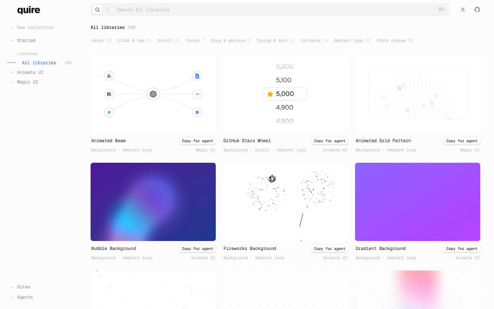

<p align="center">
  <picture>
    <source media="(prefers-color-scheme: dark)" srcset=".github/assets/wordmark-dark.svg">
    
  </picture>
</p>

<p align="center">
  A reference gallery of UI components, micro-interactions and animations, organized by type, that your AI agent reads over MCP.
</p>

<p align="center">
  <a href="https://quire.fyi">Website</a> ·
  <a href="#features">Features</a> ·
  <a href="#browser-extension">Extension</a> ·
  <a href="#getting-started">Getting started</a> ·
  <a href="#contributing">Contributing</a>
</p>

<p align="center">
  <picture>
    <source media="(prefers-color-scheme: dark)" srcset=".github/assets/app-dark.png">
    
  </picture>
</p>

## Features

- **Curated library.** 1,984 components from 20 component sites (Magic UI, Aceternity UI, React Bits, Animate UI, Motion Primitives, Cult UI, Kokonut UI, SmoothUI, Animata and more), read from each site's registry or repo.
- **Or start from scratch.** Begin empty and paste the link of each component library you want. Quire reads its registry, pages or sitemap and adds every component.
- **Organized by type, not by site.** Every component gets a type (button, dock, text effect, background…), the motion that drives it (hover, scroll, cursor, drag, loop…) and the tech it uses (Motion, GSAP, Three.js).
- **Detail like a gallery.** Preview, credit and link to the source, install command, and the real source code.
- **MCP for agents.** `/api/mcp` serves the curated library, or your own library with your key. Tools: `recommend`, `search_components`, `get_component`, `get_component_source`, `get_filters`, `list_libraries`.
- **Collections and notes.** Save components, group them, add a note for your agent. ⌘K searches and exports.

## MCP

```bash
claude mcp add --transport http quire https://quire.fyi/api/mcp
```

Open **Agents** in the app to connect your own library. You get the same address with a private `key`.
Start an agent with a brief, for example "pricing page with a playful toggle and a magnetic button". It calls
`recommend`, then `get_component_source` for the references it adapts.

## Curated catalog

`lib/catalog/data.json` is generated. The sources live in `scripts/catalog/sources.ts`.

```bash
node scripts/build-catalog.ts            # all sites
node scripts/build-catalog.ts magicui    # one site
```

Previews come from the libraries' own repos where they keep them. The rest come from the capture service in
[`capture/`](capture/README.md), which runs Chromium on a VPS and records a still and a short clip of each component.

## Browser extension

`extension/` contains a Chrome extension (Manifest V3).

1. Open `chrome://extensions` and turn on Developer mode.
2. Click **Load unpacked** and select the `extension/` folder.
3. Click the icon or press Alt+S on a component page to save it. A page from the curated catalog keeps its source for your agent.
4. Press Alt+Shift+S, or right-click, to add the whole component library you are on.
5. On x.com, click the quire button next to X's bookmark button to save a post.

The extension saves to [quire.fyi](https://quire.fyi). To use your own instance, set its address in the extension options.

## Getting started

```bash
git clone https://github.com/rickmff/quire.git
cd quire
npm install
npm run dev
```

Open [localhost:3000](http://localhost:3000). The landing page is at `/` and the app is at `/app`.

The link preview API (`/api/meta`) blocks private network addresses. In a sandbox without DNS, set `QUIRE_SKIP_DNS_CHECK=1` for local testing only.

### Environment

| Variable | Needed for |
| --- | --- |
| `CF_ACCOUNT_ID`, `CF_KV_NAMESPACE_ID`, `CF_API_TOKEN` | Syncing personal libraries so the MCP can read them (Cloudflare KV, token with KV edit rights). Upstash also works: `UPSTASH_REDIS_REST_URL`, `UPSTASH_REDIS_REST_TOKEN`. In development, libraries go to `.data/`. |
| `QUIRE_CAPTURE_URL`, `QUIRE_CAPTURE_TOKEN` | Previews for components added by link. See [`capture/`](capture/README.md). |

Without them, the curated library and its MCP still work.

## Tech stack

[Next.js](https://nextjs.org), [React](https://react.dev), [Tailwind CSS](https://tailwindcss.com), [cmdk](https://cmdk.paco.me) and [Geist](https://vercel.com/font).

## Contributing

Issues and pull requests are welcome. For a large change, open an issue first to discuss it.
