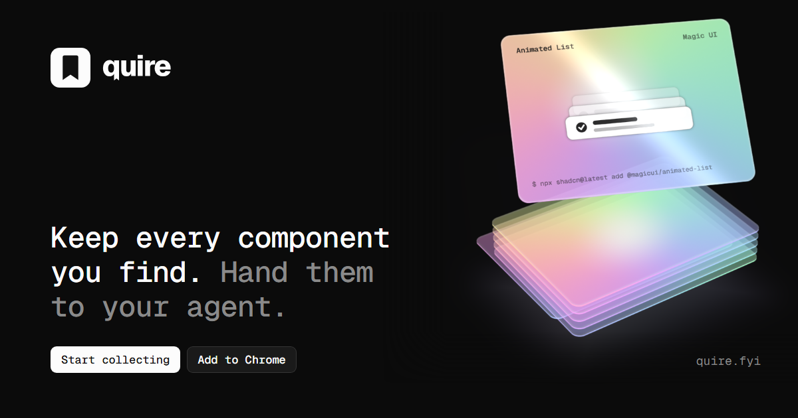
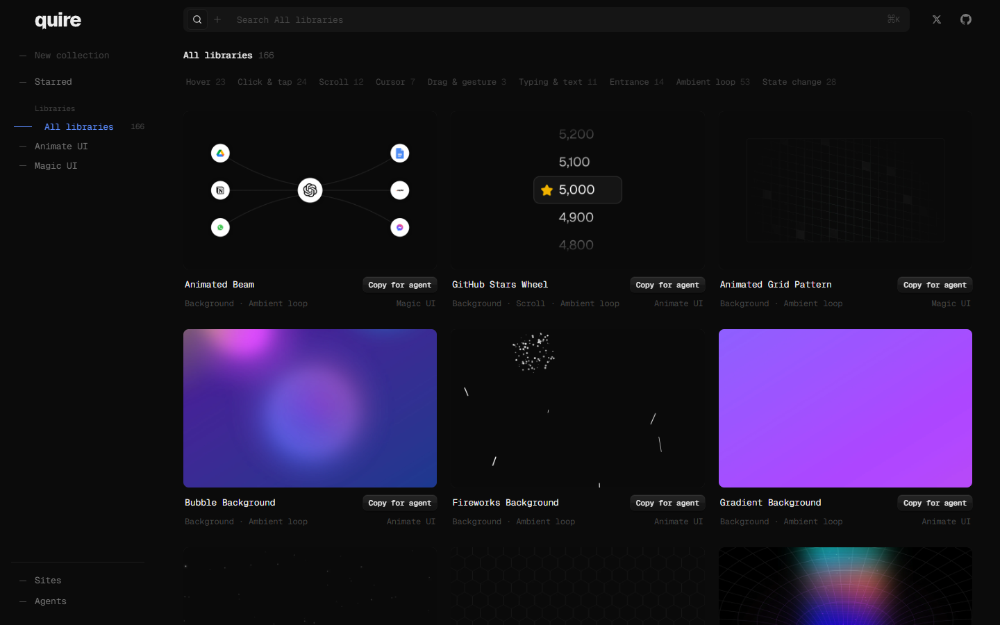

<p align="center">
  <a href="https://quire.fyi"></a>
</p>

<p align="center">
  <a href="https://github.com/rickmff/quire/actions/workflows/ci.yml"></a>
  <a href="https://github.com/rickmff/quire/releases"></a>
  <a href="LICENSE"></a>
</p>

## The problem

- Great UI components get bookmarked and lost.
- Your AI agent never sees them, so it builds something generic.

## How Quire solves it

- **One gallery** for every component and library you find.
- **Live cards** show how each component moves.
- **Hand it to your agent** with one click, over MCP, or with the skill.

<p align="center">
  
</p>

## Use it with your agent

Add the MCP server to Claude Code:

```bash
claude mcp add --transport http quire https://quire.fyi/api/mcp
```

Any other MCP client, such as Cursor, takes the same URL over HTTP. Or install the skill, which tells the agent when
and how to use Quire:

```bash
npx skills add rickmff/quire --skill quire
```

[docs/mcp.md](docs/mcp.md) lists the tools.

## Run it locally

```bash
npm install
npm run dev
```

Open [localhost:3000](http://localhost:3000). It runs with no keys. Every variable in [.env.example](.env.example) is
optional:

| Variables | What they turn on |
| --- | --- |
| `UPSTASH_REDIS_REST_URL`, `UPSTASH_REDIS_REST_TOKEN` | Library sync between devices, and one rate limit shared by every server instance |
| `CF_ACCOUNT_ID`, `CF_KV_NAMESPACE_ID`, `CF_API_TOKEN` | Read libraries synced before the move to Vercel, from Cloudflare KV |
| `QUIRE_FILE_STORE` | Set to `1` to keep synced libraries in `.data/` in a production build |
| `QUIRE_PROXY_SECRET` | Trust the client address from the Cloudflare proxy |
| `QUIRE_PREVIEWS_URL`, `BLOB_READ_WRITE_TOKEN` | Card previews served from Vercel Blob |
| `QUIRE_CAPTURE_URL`, `QUIRE_CAPTURE_TOKEN` | The optional capture service in `capture/` |
| `QUIRE_ADMIN_TOKEN`, `QUIRE_GITHUB_*` | Importing a library on the server |

## Contribute

- [CONTRIBUTING.md](CONTRIBUTING.md): setup, code rules and checks.
- [docs/architecture.md](docs/architecture.md): how the parts fit together.
- [SECURITY.md](SECURITY.md): report a vulnerability privately.

## License

[MIT](LICENSE). Third-party components: [THIRD_PARTY_NOTICES.md](THIRD_PARTY_NOTICES.md).
