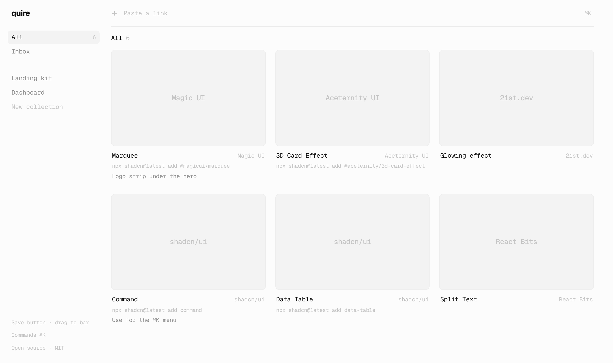

<p align="center">
  <picture>
    <source media="(prefers-color-scheme: dark)" srcset=".github/assets/wordmark-dark.svg">
    
  </picture>
</p>

<p align="center">
  Save components from any UI library, organize them into collections, and hand them to your AI agent.
</p>

<p align="center">
  <a href="https://quire.fyi">Website</a> ·
  <a href="#features">Features</a> ·
  <a href="#browser-extension">Extension</a> ·
  <a href="#getting-started">Getting started</a> ·
  <a href="#contributing">Contributing</a>
</p>

<p align="center">
  <picture>
    <source media="(prefers-color-scheme: dark)" srcset=".github/assets/app-dark.png">
    
  </picture>
</p>

## Features

- **Save links.** Paste a component URL anywhere in the app (⌘V). quire adds a card with title, description and preview image.
- **Library detection.** quire recognizes 24 sources, including shadcn/ui, Magic UI, Aceternity UI, 21st.dev and React Bits. For shadcn registries it adds the `npx shadcn add` command.
- **Collections.** Group cards in the sidebar. Drag a card onto a collection to move it. Double-click a collection to rename it.
- **Notes.** Add a note to each card for your agent.
- **Command palette.** ⌘K searches every card, filters by library, and exports a collection as Markdown or JSON for an AI agent.
- **Keyboard.** Arrows or `h` `j` `k` `l` to move, `Enter` to open, `c` to copy, `Backspace` to delete.
- **Local first.** Data stays in your browser. Export and import JSON backups from ⌘K.

## Browser extension

`extension/` contains a Chrome extension (Manifest V3).

1. Open `chrome://extensions` and turn on Developer mode.
2. Click **Load unpacked** and select the `extension/` folder.
3. Click the icon or press Alt+S on any page to save it.
4. On x.com, click the quire button next to X's bookmark button to save a post. The card keeps the post text and first image.

The extension saves to [quire.fyi](https://quire.fyi). To use your own instance, set its address in the extension options. A bookmarklet in the app sidebar does the same job without the extension.

## Getting started

```bash
git clone https://github.com/rickmff/quire.git
cd quire
npm install
npm run dev
```

Open [localhost:3000](http://localhost:3000). The landing page is at `/` and the app is at `/app`.

The link preview API (`/api/meta`) blocks private network addresses. In a sandbox without DNS, set `QUIRE_SKIP_DNS_CHECK=1` for local testing only.

## Tech stack

[Next.js](https://nextjs.org), [React](https://react.dev), [Tailwind CSS](https://tailwindcss.com), [cmdk](https://cmdk.paco.me) and [Geist](https://vercel.com/font).

## Contributing

Issues and pull requests are welcome. For a large change, open an issue first to discuss it.
