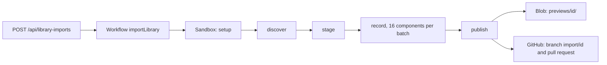

# How Quire works

The code has no comments (see [AGENTS.md](../AGENTS.md)). What the code cannot say by itself, such as why
something is done a certain way, which values must stay in step across files, and how the moving parts fit
together, lives here.

## Routes and views

The gallery lives in `app/app/layout.tsx`, above the pages, so moving between views keeps it mounted: no
reload and no second deal. `app/app/page.tsx` and `app/app/[...view]/page.tsx` render no markup of their own.
They set the metadata and, for a catalog view, a `CollectionPage` JSON-LD with its components.

`lib/pages.ts` lists every catalog view worth a search result: All libraries, each library, each library's
categories and each component type. Each one is prerendered with its own title, description and canonical, and
listed in the sitemap and in `/llms.txt`. The page list and the view URLs come from the same `viewPath`, and
`lib/pages.test.ts` checks that each path opens the same view in the app. Collections live in the browser, so
their pages render on demand with `noindex`.

The address is the source of truth. Picking a view pushes its path; back, forward or a link moves the view.

| Path | View | `view` value (`lib/view.ts`) |
| --- | --- | --- |
| `/app` | Starred | `"starred"` |
| `/app/all-libraries` | All libraries, category by category | `"libraries"` |
| `/app/all-libraries/<library>[/<category>]` | One library, or one of its categories | `"site:<key>"`, `"site:<key>\|<group>"` |
| `/app/types/<type>` | One component type across the library | `"type:<id>"` |
| `/app/collections/<id>` | A collection | the collection id |
| `/app/sites`, `/app/agents` | Sites, Agents | `"sites"`, `"agents"` |

The old `"library"` and `"all"` views open Starred. A category is its family (`input`) or, for a family split
by type, the type (`text-effect`). Curated components group by library id; links the user added group by the
site they came from.

`/app?import=<url>` opens the import dialog for a whole site; the extension uses it. `/add?url=` is the
extension's save page and is kept out of search, as is `/api`. Both belong to adding by link, which is off
unless the build sets `NEXT_PUBLIC_QUIRE_USER_ADDS=1`; [user-adds.md](user-adds.md) lists every part of it.

## First load of /app

`lib/useIntro.ts` runs the entrance on every entry, from a refresh or from the landing:

```
wait ──dealt(ms)──▶ deal ──ms──▶ show ──900ms──▶ done
  │                                ▲
  ├──nothingToDeal or 1600ms───────┘   nothing to deal, or the catalog is slow
  └──reduced motion──▶ done
```

- `wait`: the chrome is hidden until the gallery has its cards and deals them.
- `deal`: the cards are in flight; the chrome waits for the last one to land.
- `show`: the sidebar and headers rise in.
- `done`: no entrance; later views mount as they are.

The phase is also the page's `data-intro` attribute (absent when done), which `app/globals.css` uses to hide
and raise the chrome. A phase moves only from the phase it expects, so a late timer or a second call does
nothing. Starred cards exist before the catalog arrives, so the deal waits until every card of the view is in.
`nothingToDeal` (a page that is not a gallery, or an empty one) and reduced motion are inputs read during
render, so the phase moves before the first paint instead of one frame later. Reduced motion is read with
`useSyncExternalStore` and is unknown (`null`) on the server, so the server always renders `wait`.

The catalog is fetched as `/api/catalog?v=<version>`. `next.config.ts` makes the version from a hash of
`lib/catalog/data.json` and the deployment id, and serves that URL as `immutable`, so a browser downloads the
180 KB once per deploy. `app/app/layout.tsx` preloads it, so the request starts with the page and not after
hydration. The bare `/api/catalog` stays uncached for scripts and agents.

`lib/deal.ts` deals the visible cards out of one pile, using transforms and opacity only, so the grid keeps its
final layout. The first frame of a new page is long (layout, images), so the pile is shown standing still
through it and the clocks start once it has painted.

## Landing to /app hand-off

"Start collecting" (`components/StartLink.tsx`) asks the WebGL hero (`components/Quire3D.tsx`) to settle its
sheets into one flat pile under a camera that rises to look straight down. When it has settled, the hero sends
the page where the pile is and how each sheet's foil sits. `lib/deal.ts` draws an HTML pile in the same frame,
and `/app/all-libraries` deals that pile instead of making its own. The two piles are drawn in exactly the same
place, so the landing's copy can go at once; a fade would show two piles. If the hero stalls (a background tab),
the link goes anyway. Without WebGL a pile lies down over the stage instead. With reduced motion, or a click
with a modifier key, it is a plain link.

The HTML pile imitates the shader, so these values are kept in step by hand:

| In `lib/deal.ts` | Must match |
| --- | --- |
| Foil palette `foilAt(h) = 0.8 + 0.2 cos(2π (h − [0, 1/3, 2/3]))`, the per-sheet hue offset `fi * 0.061`, the key light falloff `exp(−r² / 0.55)`, the wash-out at the pinwheel's centre (smoothstep to 0.6 units, to 0.95 grey) | `FRAG` in `components/quire3d/shader.ts` |
| Sheets of 2 by 1.5 world units | `HALF` in the shader |
| Where the stack is drawn | the resize code in `Quire3D.tsx` |
| Pile turn per sheet (`pileRot`) | `pileTurn` in `components/quire3d/scene.ts`, in radians |
| Seven sheets | `SHEETS` in the shader |

## The hero

`Quire3D` ray traces seven glass sheets in one fullscreen pass. Each sheet is a plane with a rounded-rect
footprint, so the intersection is analytic and the edges are antialiased from the SDF. Sheet `i` sits in slot
`(i + turn) mod N`: slots `0..N-2` are the stack and slot `N-1` is the sheet handed over. The turn is a spring,
so it can be dragged. The components on the sheets keep their state in JS, so the pointer can drive them.

Below 1.5 device pixels per CSS pixel the hero renders at twice the screen and lets the browser average it
down, because the sheet's text and edges are too coarse otherwise. When frames run slow it drops the
supersampling first, then resolution. The label atlas uses anisotropic filtering because the text is seen at a
slant.

Files stay under 400 lines (`max-lines` in `eslint.config.mjs`). `components/Quire3D.tsx` is the one exception:
its render loop, pointer handlers and springs share about forty values inside one effect, so splitting it would
pass them around as arguments. Its constants and pure helpers live in `components/quire3d/scene.ts`, the shaders
in `components/quire3d/shader.ts`. `components/Hero3D.tsx` loads it with `next/dynamic` after the first paint, so
the landing's text does not wait for the WebGL code.
`e2e/quality.spec.ts` turns WebGL 2 off, so axe checks the flat fallback: in CI the hero runs on a software GPU
and starves the page of time.

## Gallery cards

A card runs its component live, in an iframe from the stage build, as soon as the mouse means it. Only one card
runs live at a time. `useCardLive` in `components/gallery/useCardLive.ts`, one controller object per card:

```
off ──start──▶ loading ──ready──▶ shown
 ▲                │                 │
 └────── end ─────┘    end ──▶ (grace, 250 ms) ──▶ off
```

Rest and dwell timers arm a start (one after the mouse stops, one after 300 ms on the card); grace delays the
end of a shown demo. A start or an end clears all three; a move clears rest and grace only, so dwell keeps
counting. The enter and leave events are the page's own, not React's: the variants menu is a portal, outside the
card in the DOM but inside it in React, and leaving the card for the menu must count as leaving.

The variants menu on a live preview opens in a ring around its gear:

```
closed ──open──▶ open (grown: false) ──next frame──▶ open (grown: true)
  ▲                   │  ▲                                 │
  └──── close ────────┘  └── pick a choice or go back ─────┘
```

`lib/ring.ts` lays the ring out from the labels' real widths. Each pill hangs off the ring by its inner edge, so
a long label only grows away from the centre and keeps its full text. The radius is the smallest at which no two
pills touch; when even the largest radius is too crowded, the pills stack down the ring's two sides, one row
each.

Starring a card moves it to the top with a FLIP animation. Card clips play only while on screen (one shared
`IntersectionObserver`); with reduced motion, only while the mouse is over them. A card swaps its clip for the
live demo when the mouse comes in slowly (under 0.35 px/ms), slows down or stops on it, or stays on it for
300 ms; the clip comes back 250 ms after the mouse leaves, and one card runs a demo at a time.

## The gallery's state

```
localStorage "quire:v1" ◀──▶ lib/store.ts (external store) ──useLibrary──▶ App
                                                                 │
             useViewRoute (address ⇄ view)  useGalleryData (what each view shows)
                                                                 │
             useLibraryActions (star, add, import, collections, copy, sync) ──update──▶ store
```

- The library is an external store read with `useSyncExternalStore`: the server and the hydration pass see an
  empty library and `ready` false, then the browser's copy. `update` applies the change, writes localStorage and
  notifies; a `storage` event from another tab reloads it. `writeLibrary` from the save page and the sync's
  `syncedAt` stamp go through the same store.
- With a sync key, changes to bookmarks, sources or mode are pushed 1.2 s after the last one; the push reads
  the latest library through `useEffectEvent`.
- The address is the source of truth for the view (see Routes); `useViewRoute` follows it during render.
- `components/App.tsx` reads `?import=` once the catalog has loaded, in an effect, because following a curated
  site or opening the dialog needs the catalog. It is the one place that sets state from an effect, and the
  ESLint rule is turned off on that line only.
- ESLint allows plain ``: previews and favicons are files Quire serves itself or third-party images it does
  not resize, and the worker has no image optimizer.

## Taxonomy

`lib/types.ts` maps every component to a fixed set of types so that references from different sites line up.
Order matters: the first matching type wins, so specific types come before broad ones. The signals are read
strongest first: the component name, then the site's category, then the description. `lib/motion.ts` is the
second axis, what makes a component move (hover, scroll, ...), read from the name first and then the
description.

## Synced libraries, the MCP and the network

- The library key is a random secret held by the browser. Whoever has it can read and replace that library.
  The server accepts only the known fields, with size caps (`lib/sync.ts`).
- `lib/kv.ts` uses Upstash Redis over REST (`lib/redis.ts`; the Vercel Marketplace names `KV_REST_API_URL` and
  `KV_REST_API_TOKEN` work too), Cloudflare KV over its REST API, or local files in `.data/` for development.
  When both Redis and Cloudflare KV are configured, a read that misses in Redis falls back to Cloudflare KV and
  copies the value into Redis. Libraries saved before the move to Vercel move over the first time they are
  read, so the Cloudflare variables can be removed once no old key is expected.
- `/api/mcp` is a Model Context Protocol server over Streamable HTTP, written without an SDK. It answers
  JSON-RPC with plain JSON responses (no SSE stream), which the spec allows. `GET` returns 405 so clients use
  POST only. Every tool is read-only. The key comes from `?key=`, the `x-quire-key` header or a bearer token.
  `recommend` takes at most two references from one library.
- `lib/net.ts` fetches user-supplied URLs without reaching private network addresses, checking every redirect
  hop and capping the size. `QUIRE_SKIP_DNS_CHECK=1` turns the check off for sandboxes without DNS; never set
  it in production.
- `lib/capture.ts` is off unless both `QUIRE_CAPTURE_URL` and `QUIRE_CAPTURE_TOKEN` are set.

## Security

- Quire has no accounts, passwords, admin area, payments or file uploads. The only credential a visitor holds is
  the library key. It has at least 124 bits of randomness, so it cannot be guessed, and reads and writes are rate
  limited.
- `lib/security.ts` refuses writes that a browser marks as coming from another site (`Sec-Fetch-Site` or an
  `Origin` from another host). `PUT /api/library/:key` and `POST /api/capture` use it. Clients that send neither
  header, such as scripts holding the key, still work. `/api/mcp` stays open to every origin (`*`) because MCP
  clients call it from anywhere; it is read-only and uses no cookies.
- `lib/rateLimit.ts` counts in Redis when it is configured, one fixed window per route and client, so every
  function instance shares the count. Without Redis, or when Redis fails, it counts in memory per instance.
- quire.fyi is proxied by Cloudflare in front of Vercel, so Vercel sees a Cloudflare address as the client.
  A Cloudflare Transform Rule adds the `x-quire-proxy` header with the value of `QUIRE_PROXY_SECRET`. Only
  requests that carry it have their `cf-connecting-ip` trusted; anyone else can forge that header by calling
  the Vercel URL directly. Without the secret, the client is `x-real-ip`, which Vercel sets.
- Refused requests (rate limit, cross-site) are logged as one JSON line with `kind: "security"`. Vercel runtime
  logs keep them (one hour on Hobby); filter on that field.
- `next.config.ts` sets the headers for every response, static files included, because Vercel applies them to
  `public/` too. `script-src` keeps `'unsafe-inline'` because Next.js inlines its bootstrap and its RSC payload
  in every prerendered page. `experimental.sri` only hashes the script files, not those inline scripts, and a
  nonce needs a fresh render per request, which would end the static pages and their CDN cache. The rest of the
  policy narrows what an injected script could do: `script-src-attr 'none'` blocks inline event handlers,
  `connect-src`, `form-action` and `base-uri` stay on `'self'`, and the only inline script Quire wrote, the
  service worker cleanup, is a file (`public/drop-sw.js`). `e2e/quality.spec.ts` fails on any CSP violation.
- HSTS carries `preload` with two years and every subdomain, which [hstspreload.org](https://hstspreload.org)
  asks for. Leaving the preload list takes months, so a subdomain that must serve plain HTTP cannot exist.
- `/.well-known/security.txt` points reporters to GitHub's private vulnerability reporting. Its `Expires` is a
  year after the build, so any deploy within a year keeps it valid.
- Live demos in `/stage/` run on the same origin as the app, so their code can read the app's `localStorage`,
  which holds the library key. Only curated libraries are built into `/stage/`. Anything that stores a more
  valuable secret in the browser must first move the demos to another origin.
- `capture/server.mjs` compares its bearer token in constant time and warns when the token is shorter than 32
  characters.
- `.env.example` and `capture/.env.example` list every variable. Real `.env` files are ignored by Git.

## Reading component sites

`/api/import` tries the most structured source first: a shadcn `registry.json` (listed in the public shadcn
index, hosted on GitHub and referenced by the site, or at the conventional path on the site), then links on the
page under its path grouped by the headings above them, then `sitemap.xml`. Counters such as "Inputs (6)" are
dropped from headings, and "New releases" style headings that repeat items lose to the first real category.

`lib/source.ts` reads a component's source from the live shadcn registry item first (JSON with every file
inline), then from the files in the site's GitHub repo.

## Curated catalog sources

`scripts/catalog/sources.ts` lists the libraries. Each source has a kind:

| Kind | Where the component list comes from |
| --- | --- |
| `registry` | a shadcn `registry.json` in the site's GitHub repo |
| `mdx` | docs pages in the repo, one `.mdx` per component, title and description in front matter |
| `pages` | a docs folder in the repo, one page per component, name only |
| `manual` | `scripts/catalog/manual.json`, for sites with no public repo |

`build-catalog.ts` reads each repo with a blobless clone, so it needs no API token. Previews from the Quire
stage win over a library's own media; captures fill in where there is none. `dedupe.ts` keeps one card per
component when a library publishes copies (Animate UI ships styled and primitive versions for Radix, Base UI
and Headless UI).

## Importing a library

`npm run import -- <site> [--repo owner/name]` brings a shadcn-registry library into the catalog with the same
previews as the curated ones. It runs six steps, and `--from` and `--until` run part of them:

| Step | What it does | Stops when |
| --- | --- | --- |
| `discover` | Finds the library in the shadcn directory, its GitHub repo (from the site, or `--repo`), its license and its `registry.json`. Writes the source to `scripts/catalog/imported.json` and the stage settings to `stage/libs.json`. | The license is not MIT, Apache-2.0, BSD, ISC, 0BSD or Unlicense, or it adds the Commons Clause, non-commercial or no-redistribution terms. No registry lists components. |
| `catalog` | `build-catalog.ts <id>`. | |
| `stage` | `stage/setup.sh` and `stage/build.sh`. | The Vite build fails. |
| `record` | Serves the stage and runs `capture.mjs` and `video.mjs`. | |
| `publish` | `stage/publish.mjs`. | |
| `summary` | Writes `stage/out/<id>/summary.md`: counts and every component without a preview or with render errors. | |

The docs URL comes from the component pages in the repository. When they sit in more than one folder (Kokonut
UI keeps them by category, `docs/navigation/<name>`), the source gets `docsPages` and `build-catalog.ts` maps
each component to its own page; the template is only the fallback. `record` stops if the stage port already
answers, so a server left by an earlier run is never recorded by mistake.

The license check reads the file, not only `package.json`, because several libraries declare MIT there and add
the Commons Clause in the file. A refused library is not imported; ask its author or leave it out.

Some libraries keep only the component sources in GitHub and serve their `registry.json` from the site, often
next to Pro items behind a license key. Prestige UI is one. For these, save the site's `/r/registry.json` under
`scripts/catalog/registries/<id>.json` and pass `--registry` with that path. The import then reads the items from
that file and the sources from the repository, so the cloud and CI never need to reach the site. Items marked
`"access": "pro"` are dropped in `discover`, `build-catalog.ts` and `install.mjs`. When an item's `path` is not in
the repository (`registry/...`), the file is looked up at its `target` (`components/...`). `--docs` takes `{kind}`,
which becomes `blocks` for `registry:block` items and `components` for the rest. `--full-titles` builds the title
from the name when the registry gives a one-word title that only makes sense inside a group ("Pill" for
`navbar-pill`). Pass it last, after the site or scope. To refresh the snapshot, fetch the file again and rerun the
import.

The stage template accepts `forwardRef` and `memo` exports as the component to render, not only functions.
A library without demo items gets its demos from `stage/custom/<id>/<name>.tsx`, which win over registry demos.
Prestige UI ships no demos, so every component that needs data or a label has one there, with inline SVG images so
the capture makes no network requests.
uibrik ships no demos either. Its text effects take a `play` count that must be a number, and its shader
backgrounds fill their parent, so they render nothing on their own. `stage/custom/uibrik` gives each of them data, a
size, or a timer that bumps `play` so the clip shows the effect. The props come from each component's "Render it"
section at `https://uibrik.com/components/<name>.md`. Five components (email composer, event feed, open source, org
chart, testimonial carousel) load their default avatars from uibrik.com, which the cloud capture cannot reach.

`stage/libs.json` holds what `install.mjs` needs per library: the repo, the folder of built registry items, the
source roots, and whether demos are named `<name>-demo` (`suffix`) or `demo-<name>` (`prefix`). When a built item
is missing, `install.mjs` builds it from the `registry.json` entry and the source files. Relative imports that no
item lists are fetched from the same source root.

Run locally, the import does not upload previews. Run `npm run previews:upload` after the pull request is
reviewed.

### The import agent on Vercel

`POST /api/library-imports` runs the same import on Vercel. It takes `{ "url": "https://site", "repo"?, "id"?,
"name"?, "docs"? }` and a bearer token equal to `QUIRE_ADMIN_TOKEN` (32 characters or more; without it the route
refuses everyone). It answers `202` with an `importId`; `GET /api/library-imports/<importId>` with the same token
returns the phase, the progress and, at the end, the pull request.



- `workflows/import-library/` holds the workflow (`index.ts`) and its steps (`steps.ts`). The workflow only
  orders steps; every step that touches the network or the sandbox lives in `steps.ts`.
- One named, persistent Vercel Sandbox per import holds the checkout. Each phase runs as a detached command that
  writes its log and exit code to `~/import-logs/`. The workflow sleeps 30 seconds between polls, so no function
  waits on a long command, and stops the sandbox after each phase so the next one starts a fresh 45-minute
  session (the Hobby limit) from the saved filesystem. A phase that runs past 44 minutes fails.
- Recording goes in batches of 16 components (`--only`), because a full library does not fit in one session.
- The sandbox gets no secrets: it installs and runs the library's code. Uploading to Blob and calling GitHub
  happen in steps, in the function, with `BLOB_READ_WRITE_TOKEN` and `QUIRE_GITHUB_TOKEN` (a fine-grained token
  with Contents and Pull requests write on the repository).
- Previews go to Blob before review, under the library's own folder, so the pull request's preview deployment
  shows the new cards. Nothing reaches `main` until the pull request is merged.
- A license refusal ends the run as `refused`; any other failure as `failed`, with the end of the phase log. The
  sandbox is deleted in both cases.
- Status lives in the KV store (`lib/imports.ts`, key `import:<importId>`).


## Config notes

- Quire deploys to Vercel from Git with no `vercel.json`: the framework preset and project settings are enough.
  Every pull request gets a preview deployment.
- Quire is dark only. `app/globals.css` holds one set of colour tokens, the hero shader and the landing deal
  have no light branch, and the stage records one image, one video and one live demo per component, all in
  the dark theme (`theme=dark`). The stage's own libraries still carry their light CSS, because the demos
  are theirs.
- Recorded previews (`public/previews/`) live in Vercel Blob, not in Git. `npm run previews:upload` sends the
  files whose size changed. `next.config.ts` rewrites `/previews/*` to `QUIRE_PREVIEWS_URL` only as a
  fallback, so a local file still wins in development and URLs in `lib/catalog/stage.json` stay relative, which
  keeps the CSP at `'self'`.
- `@vercel/analytics` and `@vercel/speed-insights` load from `/_vercel/`, on the same origin, so the CSP needs no
  extra host. They do nothing outside Vercel.
- CI uses Node 24, the Vercel default.
- `app/layout.tsx` and `components/app/useDropServiceWorkers.ts` remove any service worker on the origin and reload once. Quire
  registers none, but `localhost:3000` is shared by many projects and a stale worker breaks hydration.
- On quire.fyi, Cloudflare adds its managed content-signal block above `app/robots.ts`'s rules.
- `stage/setup.sh` pins `lucide-react@0.577.0` for Animate UI, because lucide-react 1.x dropped the brand
  icons (Github, Facebook) its demos use.
- The command menu is built on [UI SDK](https://ui-sdk.dev) (`@ui-sdk/react`, Apache-2.0). UI SDK is in beta, so
  `@ui-sdk/core` and `@ui-sdk/react` are pinned to one exact version and move together.
- `components/app/agent.ts` creates the UI SDK agent when the module loads, before the gallery renders, because the
  agent only hears components made after it. `App` registers its tools with the browser through WebMCP
  (`document.modelContext`) and does nothing where the browser has none. The command menu's dialog shares one
  controller with the ⌘K button, so an agent sees the closed menu as a component it can open. Commands marked
  `data-agent-confirm` (Delete collection, Import backup) are refused for agents: a person runs them.
- `CommandMenu` closes the dialog inside `flushSync` before it runs a command. While the dialog is open the rest of
  the page is inert, so a command that focuses something outside it, such as the New collection name field, must
  run after the close is committed. It runs in the same task, so keys typed right after Enter reach that field.
  Opening a bookmark stays inside the key or click event, so the browser allows it.
- Commands that open another dialog (Delete collection, Import a site) wait for `onOpenChangeComplete` instead. A
  click that lands while the command menu is still closing does not reach the new dialog, so its confirm button
  would ignore the first click. The e2e test for deleting a collection catches this on a production build.
- `lib/engine.ts` reads which headless library a component's behavior comes from (Radix, Base UI, Headless UI,
  React Aria, UI SDK), first from its name (Animate UI ships `components-radix-*` and `components-base-*`), then from
  its dependencies. `@radix-ui/react-icons` is an icon set, not an engine, so it does not count. `lib/catalog`
  adds the engine when it loads `data.json`, so the catalog build does not have to run again. The map from Quire
  types to UI SDK parts names only paths that `@ui-sdk/react` exports; when the pinned version changes, check it
  against that package's `exports`. The UI SDK prompt links the React docs root, not a page per part, because the
  per-part URLs are not stable in the beta.

## Third-party code and design

- `components/ui/select.tsx` and `components/ui/tooltip.tsx` start from [shadcn/ui](https://ui.shadcn.com)
  (MIT), restyled with Quire's tokens.
- The button styles in `app/globals.css` (`.btn`, primary, secondary, ghost) are modeled on Clerk's buttons.
